

  <a href="https://github.com/Build-With-MTT">
    
  </a>

I am the sun; my languages are the planets and my projects their moons.

  

 

  <a href="https://github.com/Build-With-MTT/zehn-ai"></a>
  <a href="https://github.com/Build-With-MTT/web3-realestate-platform"></a>
  <a href="https://github.com/Build-With-MTT/thokkhata"></a>
  <a href="https://github.com/Build-With-MTT/medichain"></a>

### Blockchain Lab

  

 

  <a href="https://github.com/Build-With-MTT/medichain"></a>
  <a href="https://github.com/Build-With-MTT/web3-realestate-platform"></a>

  <a href="https://airu-cms-235154-muhammad-talal-tariq.netlify.app/"></a>
  <a href="https://skill-bridge-marketplace-for-students.netlify.app/"></a>
  <a href="https://pakvote-muhammad-talal-tariq-235154.netlify.app/"></a>
  <a href="https://talaldapp235154.netlify.app/"></a>

  

 

  

### About

I'm **Muhammad Talal Tariq**, a Computer Science student at Air University (Aerospace & Aviation Campus, Kamra) and the founder of **MTT Digital Studio**, a freelance studio for full-stack development, graphic design, branding and video editing. I build web apps, Flutter mobile apps and blockchain projects, like **ZehnAI**, a bilingual AI assistant for Pakistani students.

**Currently:** building full-stack and Web3 projects while learning smart contract security and AI.

### Skills

- **Web:** React, Node.js, Express, ASP.NET Core MVC, SQL
- **Mobile:** Flutter, React Native
- **Blockchain:** Solidity, ethers.js, Web3.js
- **Python and AI tools**
- **Design and motion:** Adobe suite, Canva, CapCut

### Contact

  <a href="https://fiverr.com/users/maliktalal56/portfolio">
    
  </a>

 

  &nbsp;
  &nbsp;
  &nbsp;
  

  &nbsp;
  &nbsp;
  

Solar System · planets are languages, comets are recent pushes · <a href="https://github.com/Build-With-MTT">@Build-With-MTT</a>

